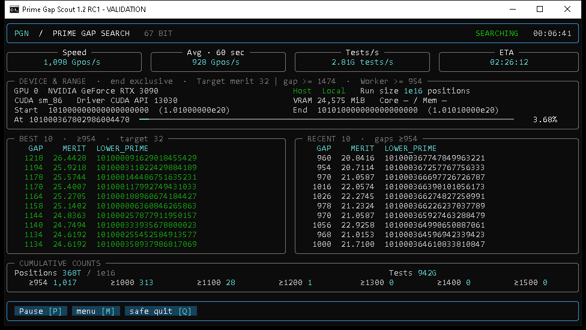

# Prime Gap Scout

A standalone NVIDIA CUDA prime-gap searcher for **67–80-bit integer ranges**, with a keyboard-and-mouse terminal interface, saved searches and resumable checkpoints.

It runs locally. No pool, wallet or blockchain connection is required.



*A real Windows session from the packaged application. The displayed rate belongs to that run; it is not a normalized benchmark or a speed guarantee for other GPUs and intervals.*

## Download

Get **[v1.2.0-rc1](https://github.com/wizz13150/prime-gap-scout/releases/tag/v1.2.0-rc1)**:

| Package | Contents |
| --- | --- |
| **Windows x64** | Portable application, CUDA workers, launchers and runtime dependencies |
| **Ubuntu x64** | Portable application built on Ubuntu 24.04, CUDA workers and launchers |
| **Complete** | Both platforms, corresponding source code, build instructions, guides and validation |

Extract the selected ZIP **completely** before launching. Release assets include SHA-256 checksums. The `Source code` downloads generated by GitHub contain this repository; use the named binary assets to run a prebuilt application.

## Start a search

**Windows:** open the extracted `Windows` folder and double-click `Start-PGN68.cmd`.

**Ubuntu 24.04:** open a terminal in the extracted `Ubuntu` folder and run:

```sh
chmod +x Start-PGN68.sh
./Start-PGN68.sh
```

A compatible NVIDIA driver is required for GPU searches. **Python and the CUDA Toolkit are not required for the prebuilt packages.** The launcher first opens the complete **Idle** dashboard so that a search starts only when requested.

1. Open **Menu → Search ranges → New**.
2. Enter a start and either a **Length** or an exclusive **End**. Exact scientific notation is accepted, for example `Start=2e20`, `Length=1e15`.
3. Choose **Start** to run immediately, or **Save range** to keep an editable Ready card.

`2e20` means exactly `200000000000000000000`; it is not parsed through a rounded floating-point value. Results default to a `results` folder beside the program.

## Working with ranges

- **Processing, Ready, Queued and Suspended** cards distinguish the active search from saved plans.
- Pause creates a checkpoint; the action changes to **Resume** after acknowledgement.
- Starting another range first checkpoints and suspends the current one.
- Reopen the application to discover previous sessions and resume compatible interrupted work.
- Open a session's results folder directly from its row.
- Browsing menus does **not** pause the GPU search.
- Every mouse action has a keyboard equivalent. The bottom action bar is clickable.

The launcher contains the public CLI settings with English descriptions. Launcher settings affect later launches; range forms affect the selected range. `Display Rows` controls both **Best** and **Recent**, from **10 to 30**, with a default of **10**. It does not truncate cumulative counts or exported results.

## Automatic minimum gap

`min-gap=auto` uses the pinned integer policy below. The effective threshold is displayed in the form and the mining dashboard, and is bound to the checkpoint.

| Bits | Minimum gap | Bits | Minimum gap |
| ---: | ---: | ---: | ---: |
| 67 | 954 | 74 | 1050 |
| 68 | 960 | 75 | 1062 |
| 69 | 982 | 76 | 1076 |
| 70 | 994 | 77 | 1090 |
| 71 | 1008 | 78 | 1104 |
| 72 | 1022 | 79 | 1116 |
| 73 | 1036 | 80 | 1130 |

The display merit target is a separate setting. Changing it does not silently change the search threshold.

## Diagnostics

**Menu → Developer diagnostics → Start recording** collects local device, search and GPU telemetry. Reproduce the behavior, then select **Stop recording**. The page shows a shareable ZIP, the files recorded, and unavailable categories.

Nothing is uploaded automatically. The application does not change GPU voltage, fan, power or clock settings. The archive explicitly lists missing profiling capabilities; a utilization percentage alone does not establish maximum achievable performance.

## Compatibility and current limits

| Target | Validation for this candidate |
| --- | --- |
| Windows x64, `sm_86` | Real application and GPU workflows tested on an RTX 3090 |
| Windows x64, `sm_120` | Native build completed; physical GPU execution not tested in this release qualification |
| Ubuntu 24.04 x86_64, `sm_86` / `sm_120` | Native builds, ELF loading and real terminal Idle/menu workflow tested; Linux CUDA hardware execution not qualified here |
| Debian / older Ubuntu | Not claimed as validated; the supplied Linux build targets Ubuntu 24.04 |

The frontend accepts `[2^66, 2^80)` as the 67–80-bit search domain. The native planner additionally checks the class-30 origin, halo and low-64-bit window of each chunk. Some boundary-crossing intervals are refused with a reason; this candidate does not claim admission of every possible interval. Total search length is not capped at `1e15`.

Optimized backends are included for all **14 retained graph profiles**, including the updated 70/71 and 78/79 paths. Other admitted high words use the compatible general backend. Performance at one graph start does not imply identical performance at every integer or on every GPU.

The final 70/71 integration comparison matched the original executables' result sets and showed no paired throughput regression. **The historical absolute graph records were not reproduced in the latest WIZZ comparison**; both the original executables and the assembled release were about 10% below them. That discrepancy remains open. See [the raw validation summary](Validation/FINAL-PERFORMANCE.json).

## Source and build

```text
Source/frontend/  Terminal UI, CLI, sessions, checkpoint ownership and reports
Source/native/    Current CUDA runtime and retained optimized arithmetic backends
Source/compat/    Corresponding historical source for pinned checkpoint workers
Docs/            English user and platform guides
Validation/      Scope and results of the release checks
```

Architecture: **[Docs/ARCHITECTURE.md](Docs/ARCHITECTURE.md)**.

Build instructions: **[Source/BUILD.txt](Source/BUILD.txt)**. Current builds use CUDA 12.8, a compatible C++ compiler, Python for the frontend and PyInstaller for portable packaging. The source build scripts discover local tool paths; no developer-machine path is required.

Keep the supplied `bin/compat` binaries and sidecars to resume checkpoints tied to their exact worker hashes. Rebuilding the same source does not guarantee the same executable hash.

Read the [user guide](Docs/USER-GUIDE.txt), [release notes](Docs/RELEASE-NOTES.txt) and [validation details](Validation/VALIDATION.txt).

## Attribution and licences

The prime-gap CUDA basis credits **Brian Kehrig** and arithmetic work by **Périg**. Python, PyInstaller, Rich, NVIDIA runtime components and other dependencies retain their respective terms.

See **[THIRD-PARTY-NOTICES](Source/THIRD-PARTY-NOTICES.txt)** and the accompanying **[licence texts](Source/THIRD-PARTY-LICENSES/)**. No blanket relicensing or additional upstream licence grant is asserted by this README.
